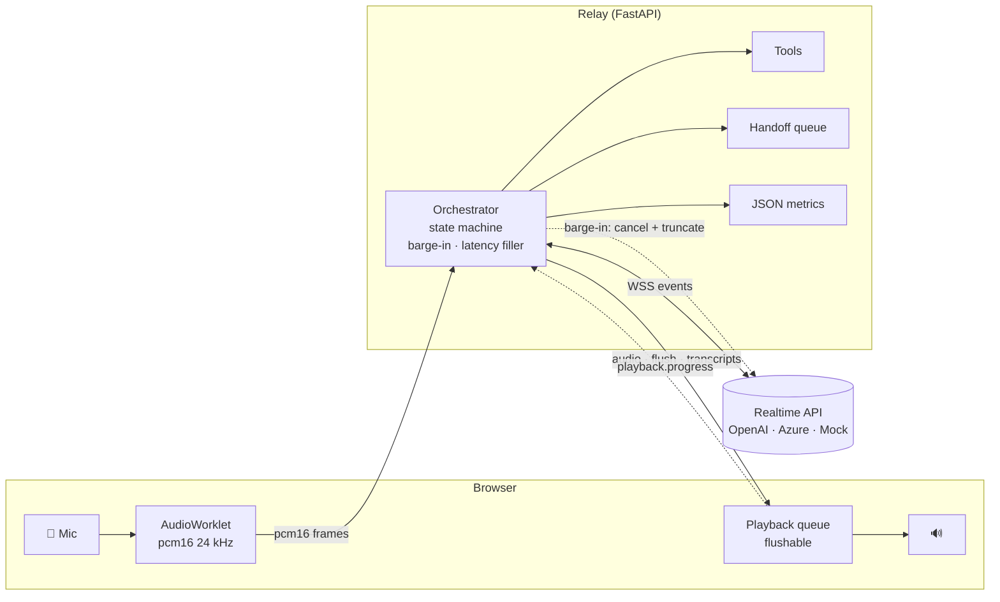

# 🎙️ Realtime Voice Agent

[](https://github.com/piyusht007/realtime-voice-agent/actions/workflows/ci.yml)


**Browser mic → Realtime LLM voice agent with barge-in, a latency-prompt pattern, two tools and
a human handoff.** A small, readable, fully tested reference for the orchestration layer that
turns a speech-to-speech model into something you could put on a phone line.

> The model does the talking. The orchestrator makes it *behave like a good agent on a call*:
> it stops when interrupted, never leaves dead air while a backend is slow, and knows when to
> hand the caller to a human with full context.

---

## What it demonstrates

| Capability | What happens |
|---|---|
| 🎧 **Streaming audio in/out** | AudioWorklet captures mic → pcm16 @ 24 kHz in 40 ms frames; server audio plays through a gapless queue. |
| ✋ **Barge-in** | On `speech_started`: `response.cancel`, `conversation.item.truncate` to the ms the caller actually *heard*, and an instant client-side playback flush. |
| ⏳ **Latency prompt** | If a tool call exceeds `FILLER_THRESHOLD_MS` (700 ms), an out-of-band filler — *"One moment while I check that for you."* — plays, then the real answer. Fast tools get no filler. |
| 🛠️ **Tool calls** | `order_status` (mock store, deliberately slow) and `book_callback`, both async, errors returned to the model as data. |
| 🧑‍💼 **Human handoff** | `escalate_to_human` publishes a summary (transcript, intent, sentiment, tools used, latency) to a queue, lets the model say goodbye, and ends the AI session. |
| 📈 **Per-turn latency metrics** | Speech-end → first-audio-byte (and → first *answer* byte) logged as one JSON line per turn and shown live in the UI. |
| 🧪 **Deterministic mock mode** | An in-process mock Realtime server speaks the same event protocol, so the demo and the test-suite run **without an API key**. |
| ☁️ **OpenAI or Azure OpenAI** | Switch with one env var. |

## Architecture



The browser is a thin audio terminal; the relay keeps the API key server-side and owns all
conversational control flow. Full component, state and sequence diagrams (normal turn,
barge-in, slow tool with filler, handoff) are in **[docs/ARCHITECTURE.md](docs/ARCHITECTURE.md)**.

## Quickstart

Requires Python 3.11+ and a modern browser with AudioWorklet support.

### 1. Mock mode (no API key)

```bash
git clone https://github.com/piyusht007/realtime-voice-agent.git
cd realtime-voice-agent
python -m venv .venv
source .venv/bin/activate          # Windows: .venv\Scripts\activate
pip install -e ".[dev]"
cp .env.example .env               # REALTIME_PROVIDER=mock is the default
voice-agent                        # → http://127.0.0.1:8000
```

Open the page, click **Start call** and either speak or type. The mock server uses an
energy-based VAD and a scripted caller, and replies with a soft synthetic tone plus
transcript (it is a protocol simulator, not a speech model). Try:

1. *"Where is my order 1042?"* → slow lookup → filler → answer
2. *"Book a callback for tomorrow 10am"* → fast tool, no filler
3. Talk (or type) while it is speaking → barge-in, playback flushes immediately
4. *"I want to talk to a human"* → handoff summary appears, session ends

### 2. Real API mode

```bash
# OpenAI
REALTIME_PROVIDER=openai
OPENAI_API_KEY=sk-...
OPENAI_REALTIME_MODEL=gpt-realtime

# — or — Azure OpenAI
REALTIME_PROVIDER=azure
AZURE_OPENAI_ENDPOINT=https://<resource>.openai.azure.com
AZURE_OPENAI_API_KEY=...
AZURE_OPENAI_DEPLOYMENT=<your realtime deployment>
```

Put these in `.env` (git-ignored) and run `voice-agent`. Use headphones for the best barge-in
experience; browser echo cancellation is enabled but speakers can still trigger VAD.

### 3. Tests & lint

```bash
pytest -q          # 28 tests, ~3 s, no network
ruff check . && ruff format --check .
cd web && npm run check   # syntax-check the browser modules (no dependencies)
```

## Configuration

| Variable | Default | Description |
|---|---|---|
| `REALTIME_PROVIDER` | `mock` | `mock`, `openai` or `azure` |
| `OPENAI_API_KEY` | – | OpenAI key (openai mode) |
| `OPENAI_REALTIME_MODEL` | `gpt-realtime` | Realtime model name |
| `OPENAI_REALTIME_URL` | `wss://api.openai.com/v1/realtime` | WebSocket endpoint |
| `OPENAI_BETA_HEADER` | `realtime=v1` | `OpenAI-Beta` header value; empty to omit |
| `AZURE_OPENAI_ENDPOINT` | – | `https://<resource>.openai.azure.com` |
| `AZURE_OPENAI_API_KEY` | – | Azure key |
| `AZURE_OPENAI_DEPLOYMENT` | – | Realtime deployment name |
| `AZURE_OPENAI_API_VERSION` | `2024-10-01-preview` | Realtime API version |
| `VOICE` | `alloy` | Output voice |
| `TRANSCRIPTION_MODEL` | `whisper-1` | Input transcription model (for transcript + handoff) |
| `VAD_THRESHOLD` | `0.5` | Server VAD sensitivity |
| `VAD_PREFIX_PADDING_MS` | `300` | Audio kept before detected speech |
| `VAD_SILENCE_MS` | `500` | Silence that ends a user turn — the biggest latency lever |
| `FILLER_THRESHOLD_MS` | `700` | Tool time after which the latency prompt plays |
| `FILLER_TEXT` | `One moment while I check that for you.` | What the filler says |
| `HANDOFF_FAREWELL_TIMEOUT_S` | `8` | Hard stop for the AI session after escalation |
| `MOCK_ORDER_LATENCY_MS` | `1200` | Simulated `order_status` latency (triggers filler) |
| `MOCK_CALLBACK_LATENCY_MS` | `250` | Simulated `book_callback` latency (no filler) |
| `MOCK_SPEED` | `1.0` | Mock server time scale (tests use 1000×) |
| `MOCK_THINK_MS` | `250` | Mock time-to-first-byte |
| `HANDOFF_QUEUE_PATH` | – | Optional JSONL file mirroring the handoff queue |
| `LOG_LEVEL` | `INFO` | Log level (logs are JSON) |
| `HOST` / `PORT` | `127.0.0.1` / `8000` | Bind address |

## Latency design notes

- **Measure what the caller feels.** `first_audio_latency_ms` = end of speech → first audio
  byte leaving the relay. `answer_latency_ms` = end of speech → first byte of the *real*
  answer. The gap between them is the dead air the filler removed.
- **Filler only when needed.** A fixed "let me check" on every tool call adds latency to fast
  tools and sounds robotic. The orchestrator races the tool against a timer
  (`asyncio.wait(..., timeout=0.7)`) and only speaks when the timer wins.
- **Fillers are out-of-band** (`conversation: "none"`, empty input) so they're cheap, need no
  context, and never pollute the history the model reasons over.
- **One response at a time.** Response creation is serialised through a small queue, so the
  real answer starts right after the filler response finishes generating — not after it
  finishes *playing*, since generation runs ahead of playback.
- **Truncate to what was heard, not what was generated.** The model streams audio faster than
  realtime; without truncation, after an interruption it "remembers" saying things the caller
  never heard. The client reports playback progress every 100 ms for an accurate cut point.
- **Own barge-in explicitly.** Server VAD runs with `interrupt_response: false`; one code path
  does cancel → truncate → flush, which makes it testable and avoids double-cancel races.
- **Biggest knob is VAD silence.** Dropping `VAD_SILENCE_MS` from 700 → 400 ms saves more than
  most model-side optimisations, at the cost of cutting off slow speakers.

### Sample metrics line

```json
{"event": "turn.metrics", "session_id": "b4e4f68ef192", "turn_id": 1, "source": "text",
 "first_audio_latency_ms": 1265.0, "first_audio_was_filler": true, "answer_latency_ms": 2859.0,
 "tool_calls": [{"name": "order_status", "duration_ms": 1204.0, "filler_played": true}],
 "barge_in": false, "outcome": "completed"}
```

## Project layout

```
realtime-voice-agent/
├── src/voice_agent/
│   ├── app.py            # FastAPI relay: /ws bridge, static client, /api/handoffs, /api/metrics
│   ├── orchestrator.py   # state machine: barge-in, filler, tool dispatch, handoff, metrics
│   ├── tools.py          # order_status, book_callback (mock async) + escalate_to_human schema
│   ├── handoff.py        # summary builder (intent, sentiment) + mock human-agent queue
│   ├── metrics.py        # per-turn latency records, JSON log formatter
│   ├── realtime/
│   │   ├── openai_ws.py  # OpenAI / Azure OpenAI Realtime WebSocket client
│   │   └── mock.py       # deterministic Realtime protocol simulator
│   ├── audio.py · config.py · prompts.py
├── web/                  # vanilla JS client: AudioWorklet capture, flushable player, UI
├── tests/                # pytest: barge-in, filler timing, tool dispatch, handoff, e2e, app
├── docs/ARCHITECTURE.md  # component, state and sequence diagrams
└── .github/workflows/ci.yml
```

## Compatibility notes

The relay speaks the Realtime **v1 (beta) event protocol** (`session.update` with
`input_audio_format`, `response.audio.delta`, …) and also accepts the GA event names for audio
and transcript deltas (`response.output_audio.delta`, …). If your model/endpoint only supports
the GA session shape, adapt `Orchestrator.session_config()` — it is the single place where the
session is configured.

## Roadmap

- [ ] GA Realtime session schema behind a flag
- [ ] WebRTC transport option (browser ↔ model media, relay keeps control channel)
- [ ] Pre-rendered / cached filler audio for ~0 ms latency prompts
- [ ] Semantic VAD / end-of-turn model to reduce false barge-ins on backchannels ("uh-huh")
- [ ] Tool-call cancellation when the caller changes their mind mid-lookup
- [ ] Real sentiment/intent model for handoff summaries; webhook sink for the queue
- [ ] OpenTelemetry spans per turn + Grafana latency dashboard
- [ ] Playwright test driving the browser client against the mock server

## License

[MIT](LICENSE) © 2026 Piyush Tiwari
