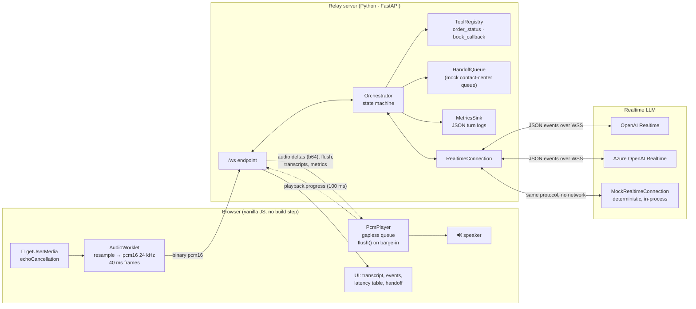
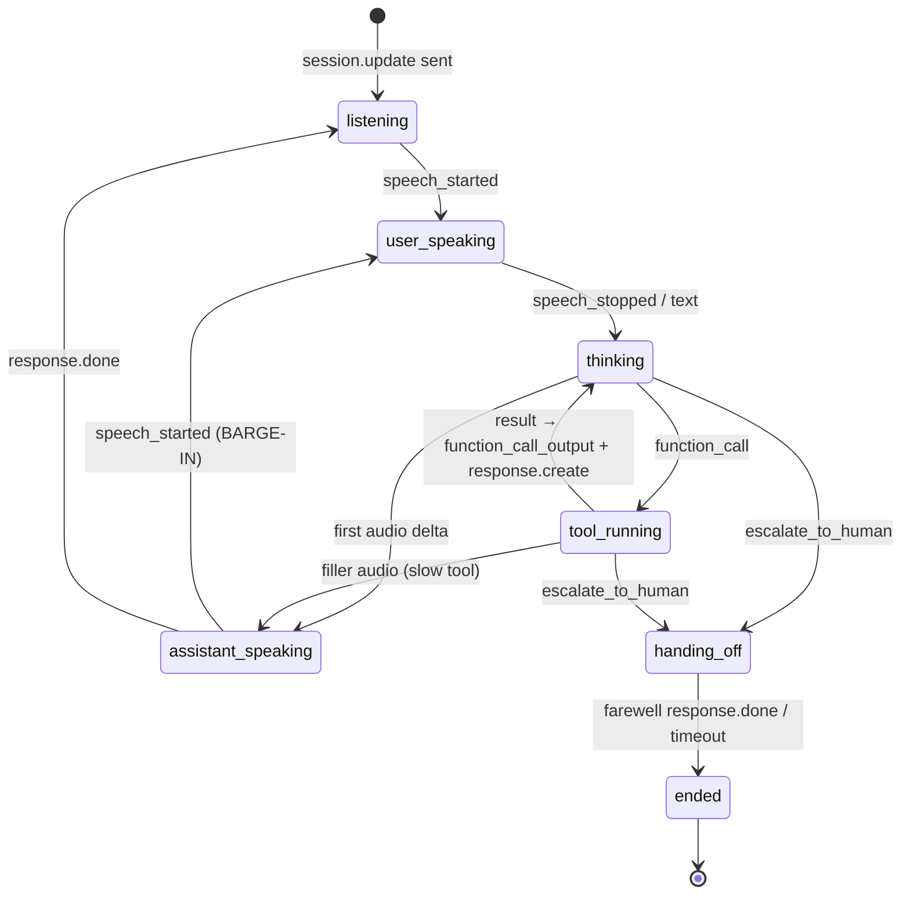
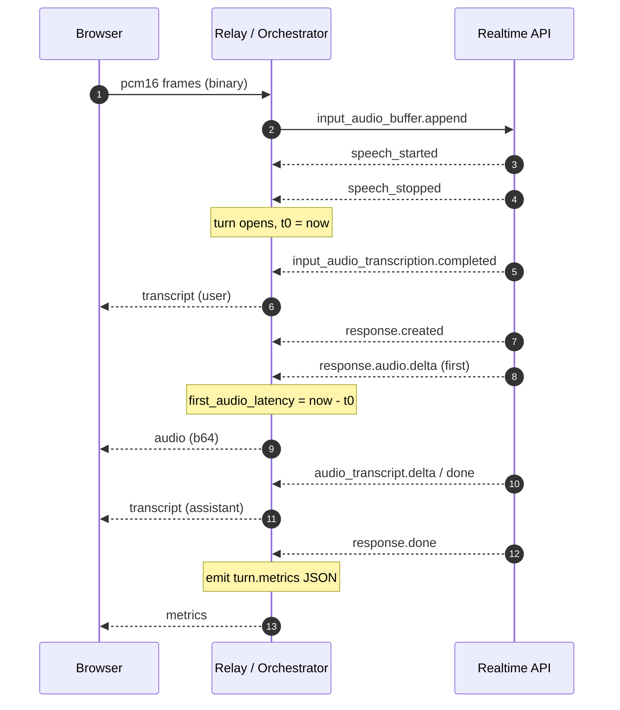
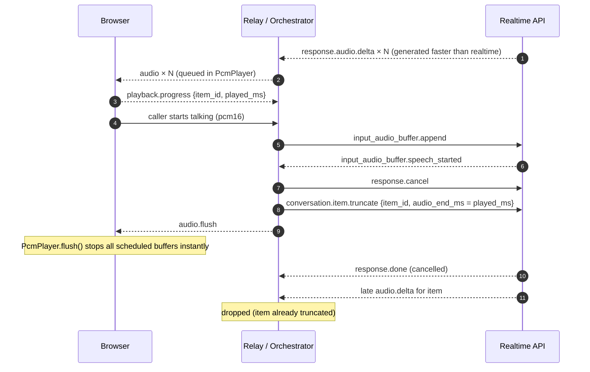
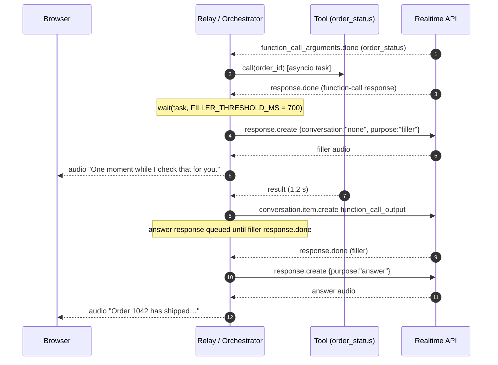
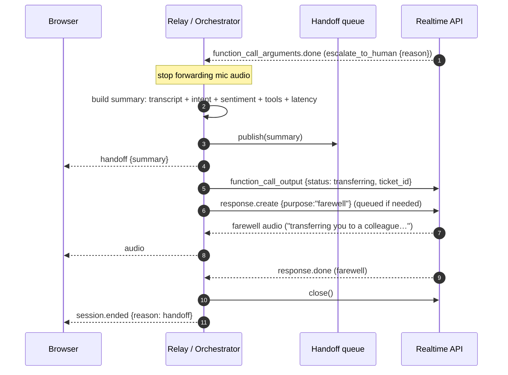

# Architecture

This document explains how audio, events and control flow move through the system, and why
the orchestration lives in a server-side relay rather than in the browser.

## Components

**Why a relay?** The API key never reaches the browser, tools run next to your data, and the
barge-in / filler / handoff logic is plain Python that can be unit-tested with fakes. The
browser stays a thin "audio terminal".

### Orchestrator states

### Key invariants

1. **At most one active response.** The Realtime API rejects `response.create` while a response
   is in flight, so every create goes through `_request_response`, which queues until
   `response.done`. The mock server enforces the same rule, so tests catch violations.
2. **The model's memory matches what the caller heard.** On barge-in the assistant item is
   truncated to `audio_end_ms = played_ms`, never to what was *generated*.
3. **Fillers are out-of-band.** They are created with `conversation: "none"` and `input: []`,
   so they never enter the conversation history and cannot confuse the next turn.
4. **Stale work is dropped.** Queued fillers are discarded when the tool finishes first or when
   the caller barges in; audio deltas for a truncated item are never forwarded.

## Sequence: normal turn

## Sequence: barge-in

`played_ms` is the latest client report plus time elapsed since it, capped at the audio
actually sent. If the client never reported, the relay falls back to "time since first audio
byte". Server VAD is configured with `interrupt_response: false` so that this single code path
owns cancellation, truncation and flushing.

## Sequence: slow tool with latency prompt

If the tool returns before the threshold, no filler is sent. If it returns after the threshold
but before the filler could start (because another response was still active), the queued
filler is discarded.

## Sequence: handoff to a human

A safety timer (`HANDOFF_FAREWELL_TIMEOUT_S`) ends the session even if the farewell never
completes, so a caller can never be stranded with a half-open AI session.

## Latency budget (where the milliseconds go)

| Stage | Typical | Lever in this repo |
|---|---|---|
| Mic frame buffering | 40 ms | `FRAME_SAMPLES` in the worklet |
| End-of-speech detection | 300–700 ms | `VAD_SILENCE_MS` (biggest single lever) |
| Model time-to-first-audio | 300–800 ms | model choice, short instructions |
| Tool execution | 0–∞ | async tools + filler after `FILLER_THRESHOLD_MS` |
| Playback scheduling | ~20 ms | `PcmPlayer` schedules 20 ms ahead |

`turn.metrics.first_audio_latency_ms` measures from `speech_stopped` (or text submit) to the
first audio byte the relay forwards, which is what the caller perceives as "dead air".
`answer_latency_ms` measures to the first byte of the *real* answer, so the effect of the
filler is visible as the gap between the two.
